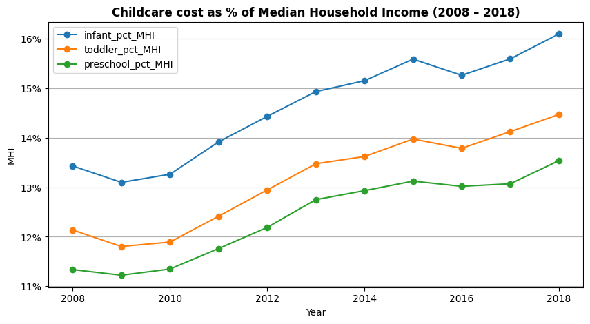
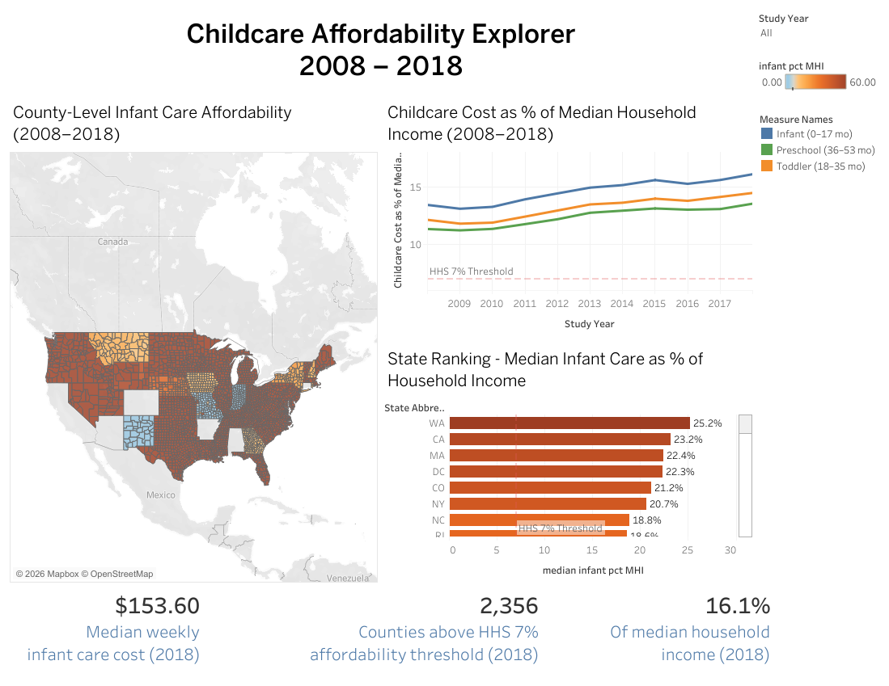
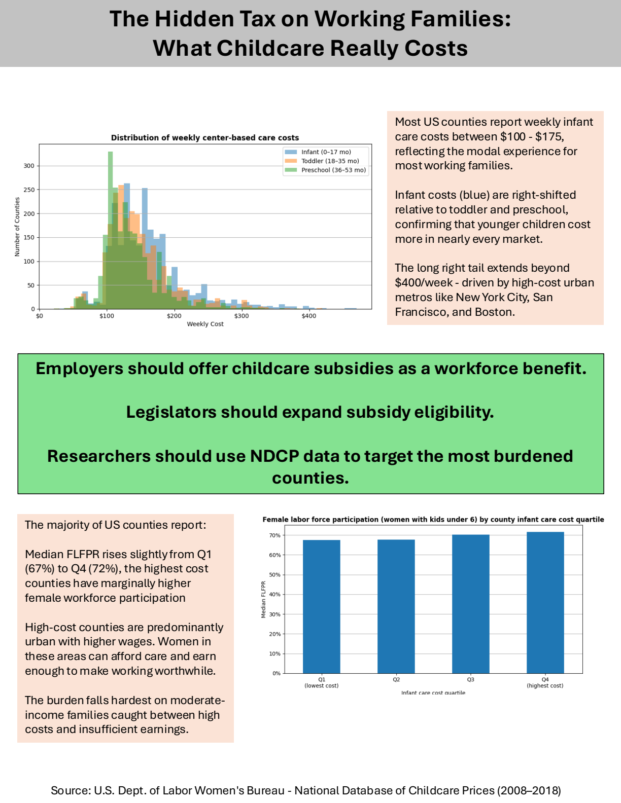

# The Hidden Tax on Working Families: America's Childcare Affordability Crisis

**How much of a family's income does childcare really take, and is it getting worse?** Using the U.S. Department of Labor's National Database of Childcare Prices, this project analyzes county-level childcare costs from 2008 to 2018 and makes the case that employers and state legislators should treat childcare support as workforce infrastructure. The story is told through three mediums, each built for a different audience: a presentation, an infographic, and an interactive Tableau dashboard.

📊 [Presentation (PDF)](childcare_presentation.pdf) · 🖼️ [Infographic (PDF)](childcare_infographic.pdf) · 📈 [Interactive dashboard (Tableau Public)](https://public.tableau.com/app/profile/leo.luera/viz/DSC640TermProjectMilestone5dashboard-Luera/Dashboard) · 📄 [Design paper (PDF)](childcare_design_paper.pdf) · 📓 [Analysis notebook](childcare_analysis.ipynb)

---

## Key Findings

- **Infant care is the most expensive tier.** In 2018, the median county charged $153.60 a week (about $7,987 a year) for center-based infant care, $28.60 a week more than preschool care, or about $1,487 more a year.
- **Childcare is taking a growing share of income.** After adjusting for inflation, infant care rose from 13.4% to 16.1% of median household income between 2008 and 2018, more than double the 7% that the U.S. Department of Health and Human Services considers affordable.
- **Almost no county is affordable.** In 2018, 2,356 of the 2,360 counties with price data (99.8%) exceeded the 7% threshold.
- **The burden is far heavier on women's earnings.** Measured against women's median earnings instead of household income, infant care rose from 29% to 33%, roughly a third of a typical woman's pay.
- **The most expensive states pay a quarter of household income.** In California, Alaska, Washington, Hawaii, and Massachusetts, infant care consumed roughly 22–25% of median household income in 2018.
- **High costs don't simply push women out of work.** Counties with the highest infant care costs actually showed slightly higher workforce participation among mothers of young children (72% vs. 67% in the lowest-cost counties), likely because high-cost counties are mostly urban with higher wages. That points to moderate-income families as the ones squeezed hardest.

## Call to Action

- **Employers:** Offer childcare subsidies or dependent-care benefits as a workforce benefit, not a discretionary perk.
- **State legislators:** Expand subsidy eligibility and funding, especially for infant care.
- **HR leaders and researchers:** Use county-level NDCP data to benchmark costs where employees live and target the most burdened counties.

## One Story, Three Mediums

| Medium | Audience | What it carries |
|--------|----------|-----------------|
| **Presentation** | HR and benefits leaders, state policy advisors | The full, presenter-guided argument: the problem, rising burden, state comparisons, workforce impact, and recommendations |
| **Infographic** | Working parents and advocates | The core message in under 30 seconds, built for print and social sharing |
| **Tableau dashboard** | Policy researchers and legislative staff | Self-guided exploration: a county map, state trend line, and state ranking connected by a shared year filter |

Each visualization appears in only one medium, so the three pieces complement rather than repeat each other.

*The Tableau dashboard: a county map, affordability trend, and state ranking, all linked by a year filter.*

## Data

- **Source:** National Database of Childcare Prices, U.S. Department of Labor Women's Bureau ([technical report](https://www.dol.gov/sites/dolgov/files/WB/National-Database-of-Childcare-Prices-Technical-Report.pdf))
- **Coverage:** 2008–2018, about 3,100 counties per year across all 50 states and DC (34,567 county-year rows, 227 variables)
- **Key variables:** Weekly median childcare prices by age group (infant, toddler, preschool) and setting (center-based vs. home-based), inflation-adjusted household income and earnings, and female labor force participation from the American Community Survey

## Approach

1. **Data quality review:** Checked missing values (about 32% of county-years lack center-based prices), coverage by year, and imputation flags by state.
2. **Feature engineering:** Converted weekly prices to annual costs, calculated each age group's cost as a share of inflation-adjusted household income and women's median earnings, and grouped counties into infant-cost quartiles.
3. **Analysis:** National and state trends, cost distributions by age group, the infant-to-preschool cost gap, and the relationship between cost and female workforce participation.
4. **Tableau preparation:** Built a county-level dashboard file plus pre-aggregated state, year, and KPI summary tables.

## Ethical Considerations

The NDCP only covers licensed providers, so informal care, which many lower-income families rely on, is missing. Some counties' prices are statistically imputed, and those cases are disclosed. Cost and workforce relationships are presented as associations, not causes, and the counterintuitive workforce finding is explained rather than hidden.

## Next Steps

- Extend the analysis with the Women's Bureau's newer release covering 2008–2022 to see how the burden changed after COVID-19
- Test the cost and workforce relationship with a regression that controls for income and urban vs. rural counties
- Pair county prices with employer turnover data to estimate the workforce cost of unaffordable care

## Tools

Python · pandas · NumPy · matplotlib · seaborn · Tableau · PowerPoint · Jupyter

---

*Completed May 2026 as the term project for DSC 640 (Data Presentation and Visualization).*
